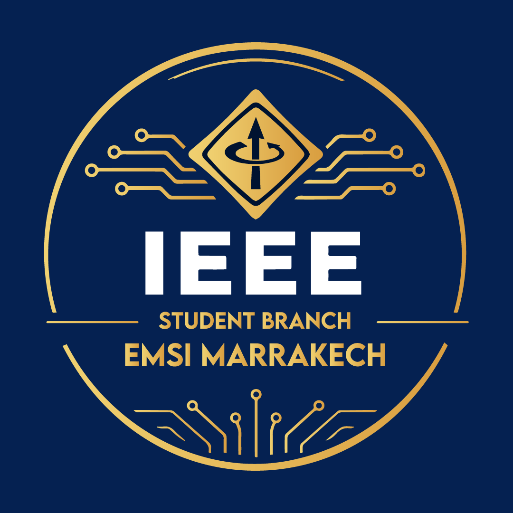

# IEEE Student Branch EMSI Marrakech

  
  <h1>IEEE S.B EMSI MARRAKECH</h1>
  
<em>Advancing Technology for Humanity</em>

## Who We Are

We are the **IEEE Student Branch at EMSI Marrakesh**, a community of passionate **students, engineers, and innovators**.  
We focus on **technology, collaboration, and hands-on learning** through real-world and open-source projects.

Our branch is part of **IEEE**, the world's largest technical professional organization, and operates under the **supervision of LAMIGEP** (Laboratoire Mathématiques, Informatique, Génie Électrique et Physique) at EMSI.

---

## Supervision and Affiliation

- **LAMIGEP**: our branch works under the supervision of the LAMIGEP laboratory, which supports us with academic guidance, research orientation and resources for our activities.
- **EMSI (École Marocaine des Sciences de l'Ingénieur)**: our host institution, which provides the environment and venues for our events.
- **IEEE**: our global network, which gives us access to a worldwide community, resources and opportunities.

---

## Mission

- Develop **technical and leadership skills**  
- Promote **innovation and research**  
- Encourage **collaboration and open-source culture**  
- Connect with the global **IEEE network**  

---

## What We Do

- **Workshops and technical training**: hands-on sessions on emerging technologies and developer tools  
- **Competitions and hackathons**: challenges where participants build and pitch real projects, such as our **Vision AI Competition**  
- **Projects and open-source**: technical projects and prototypes shared with the community  
- **Events and conferences**: talks and keynotes with academic and industry experts  
- **Networking and collaboration**: partnerships with IEEE branches and tech communities  
- **Professional development**: leadership, soft skills and career guidance  

---

## Get Involved

We welcome **students, mentors, and tech enthusiasts** from any school to join and contribute.

📧 Contact us: [ieee.sb.emsi.marrakech@gmail.com](mailto:ieee.sb.emsi.marrakech@gmail.com)  
📸 Follow us on Instagram: [@ieee.sb.emsi.marrakech](https://instagram.com/ieee.sb.emsi.marrakech)  
💼 Connect on LinkedIn: [IEEE S.B EMSI MARRAKECH](https://www.linkedin.com/company/ieee-sb-emsi-marrakech)  
🌐 Visit our website: [ieee-sb-emsi-marrakesh.vercel.app](https://ieee-sb-emsi-marrakesh.vercel.app/)  
🌍 Learn more about IEEE: [ieee.org](https://www.ieee.org)  

---

## Acknowledgment

Thanks to **LAMIGEP**, **EMSI**, and all the **members, volunteers, and mentors** who contribute to the growth of IEEE at EMSI Marrakesh 💙💛

---

> ⚡ *Advancing Technology for Humanity* — **IEEE Motto**
